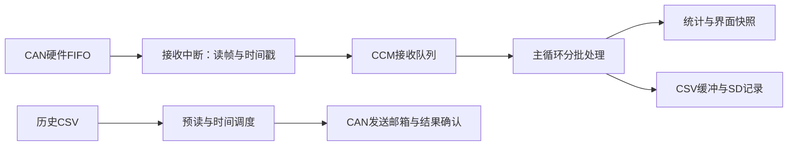

# CanSight

基于 STM32F407、LVGL 和 FatFs 的经典 CAN 接收、SD 日志及文件回放项目。采用裸机主循环和中断，当前默认 CAN 速率为 1 Mbit/s。

## 功能

- 接收标准帧、扩展帧，按 ID、IDE、RTR 组合统计最新数据和计数。
- 800×480 触摸界面，支持接收页 ID 筛选、分页，每页显示 8 条统计记录。
- CSV 持续记录到 SD 卡，约每秒同步，单文件达到 10 MiB 时自动归档并继续记录。
- 历史文件列表、删除确认、容量显示、ID 筛选及前后帧查看。
- 单文件原速回放，支持开始、暂停、继续和停止，并核对硬件发送结果。
- 保留接收、丢帧、队列峰值、写入及同步计数；串口通过固定缓冲非阻塞发送。

这是个人项目。已有正常接收、触摸交互、记录、归档和回放数量核对的实测反馈；异常恢复和长时间运行范围见[验证记录](docs/validation.md)与下文限制。

## 硬件与关键参数

| 项目 | 配置 |
| --- | --- |
| MCU | STM32F407IGH6，168 MHz，1 MiB Flash |
| 内存 | 普通 SRAM 128 KiB，CCMRAM 64 KiB |
| CAN | bxCAN CAN1，Normal 模式，1 Mbit/s |
| 位时序 | CAN 时钟 42 MHz，分频 3，BS1=11 TQ，BS2=2 TQ，SJW=1 TQ，采样点约85.7% |
| LCD | 800×480，FSMC，RGB565，CPU 同步写像素 |
| 触摸 | GT911，I²C |
| SD | SDIO＋DMA，FatFs |
| 时间戳 | TIM2 1 MHz，软件扩展为64位微秒时间 |
| 串口 | USART6，115200 bit/s，8N1 |
| 图形库 | LVGL 9.6，16 KiB 部分绘图缓冲 |

CAN 使用 Normal 模式，会对正确接收的报文提供 ACK。引脚和时钟配置见 [cansight.ioc](cansight.ioc)。

## 数据如何流动



### 接收保护

- CCM 接收队列有2048个槽位，2047帧可用；`CanFrame` 每个24字节，合计48 KiB。
- CCM 只由 CPU 使用。启动 CAN 前显式初始化，DMA 中转缓冲留在普通 SRAM。
- 每批最多处理256帧，报文之间检查约2 ms时间预算；单次同步文件操作仍可能超过该预算。
- 队列积压达到256帧时推迟 LVGL，降到64帧后恢复；历史访问也受队列阈值限制。
- LVGL 调度间隔约5 ms，页面数据约500 ms更新。繁忙时优先处理接收，显示可能延迟。
- 详细性能诊断和实验开关已从当前源码移除；完整诊断检查点为 `2f85fb2`。

## 编译与烧录

准备 CMake、Ninja、Arm GNU Toolchain，并使编译工具可从终端调用，也可以使用 STM32 开发环境提供的工具链。

在仓库根目录执行：

```powershell
cmake --preset Debug
cmake --build --preset Debug --parallel 4
```

使用 ST-Link 和 STM32CubeProgrammer 或开发环境烧录 `build/Debug/cansight.elf`。串口打开115200、8N1。

Release 构建对应：

```powershell
cmake --preset Release
cmake --build --preset Release --parallel 4
```

Debug 保留调试信息，并对 LVGL、LCD 像素填充及接收日志相关源文件启用局部 O2；Release 配置使用 Os。实测结果不应直接视为所有构建配置均已验证。

### CubeMX 重新生成代码

- 应用逻辑位于工程自行维护的文件或 `USER CODE` 区域。
- 实际 SD 驱动是 `Core/Src/sd_diskio_dma.c`；根 CMake 排除生成的 `FATFS/Target/sd_diskio.c` 模板。
- 根 CMake 从生成的链接脚本派生构建目录内的 `cansight_memory.ld`，将 CCM 设为 NOLOAD；队列由主程序清零。
- 重新生成后检查 Git 差异，确认自定义源文件仍参与构建，避免直接修改生成模板的非用户代码区。

## 使用方法

### 接收与记录

1. 连接 CAN-H、CAN-L，按硬件要求接好参考地和终端电阻，两端配置相同位速率。
2. 启动后检查 CAN 和 SD 状态；SD 正常时自动记录到 `CANLOG.CSV`。
3. 接收页输入 ID 并关闭键盘后应用筛选；只改变显示，不影响后台接收与记录。
4. 停止发送后等待缓冲处理及同步完成，再核对串口摘要。正在写卡时避免直接拔卡或断电。

当前累计计数的含义：

| 字段 | 含义 |
| --- | --- |
| `fifo` / `processed` | 从硬件取出的帧数 / 已交给统计处理的帧数 |
| `lost` / `overruns` | 软件队列丢弃帧数 / 硬件FIFO溢出事件数 |
| `peak` | 软件队列历史最大占用 / 可用容量，非当前积压 |
| `accepted` / `written` / `synced` | 日志接纳 / 写入 / 最近成功同步对应的累计帧数 |
| `buffered` / `rejected` | 尚在日志缓冲中的帧数 / 记录失败而拒收的帧数 |
| `ERROR` | CAN累计错误位、最近日志错误码、触摸I²C错误及串口丢字符计数 |

这些是不同层次的计数，不应相加。回放模式主动暂停记录不计入 `rejected`。

### SD 文件管理

- `CANLOG.CSV` 是活动日志；启动归档、手动 `Archive log` 或10 MiB自动切分后生成 `CANLOG_001.CSV` 等历史文件。
- 进入 SD 页不会主动归档，`Refresh` 重新扫描目录。
- 选中文件后 `Indexing` 分批扫描 CSV、统计帧数并在 RAM 建立稀疏定位点，不新增 SD 索引文件。
- `Frame C/D` 表示当前首行在原文件中的第 C 帧，原文件共 D 帧。
- 筛选后 `Match A/B` 表示首行在匹配结果中的第 A 条，共 B 条匹配；`Prev frame`、`Next frame` 每次移动一条匹配记录。
- `Apply` 提交历史 ID 筛选，`Clear` 清除；`Delete file` 经确认后删除历史文件，活动文件不能通过此接口删除。

### CAN 回放

1. 先停止 PCAN 的周期发送，保持正常模式接收，两端速率一致。
2. 选择历史文件，等待索引及当前文件操作完成，点击 `Replay`。
3. `Pause` 暂停后变为 `Resume`；`Stop` 结束本轮，再次 `Replay` 从头开始。切回接收页也会请求停止。

回放从文件第一帧开始，包含整个文件，不受当前浏览位置和 ID 筛选影响。保留 ID、标准/扩展与数据/远程类型、DLC及数据，按相对第一帧的时间戳调度，暂停时间从调度基准中扣除。

**回放及 Pause 期间继续接收、统计和显示，但暂停将新接收数据写入 SD。这些数据不会在结束后补存。** 完成或确认停止后恢复记录，停止未确认时保持占用并提示错误。

`late` 是最大提交延迟，不包含进入邮箱后的总线仲裁和线上传输时间。发送统计区分成功、取消、失败、未确认和在途帧；PCAN 数量应比较本轮增量，不能使用混有此前发送的累计值。

## 已有实测

完整说明见 [验证记录](docs/validation.md)。以下来自项目开发者提供的实机日志及操作反馈：

| 场景 | 结果 |
| --- | --- |
| 高负载接收及交互 | 一轮1163360帧，期间筛选、删除，接收/处理/写入/同步一致；软件丢帧、硬件溢出、日志拒收为0，自动归档5次 |
| 最近提供的精简日志 | 737404帧各层计数一致，丢帧及错误为0，归档3次，队列峰值1557/2047 |
| 标准/扩展混合 | 7路标准帧＋1路扩展帧运行约1分钟，用户反馈无报错 |
| 文件回放 | 多次回放无报错，用户核对回放数量与PCAN接收数量一致；未逐帧自动比对内容及时间间隔 |

8000帧/s是用户配置的目标负载，不等同于已测得持续精确8000帧/s或98%总线占用。当前收尾主要是源码与文档清理，本轮没有新增构建、烧录或自动测试；不能将先前实测视为所有故障路径和任意未来改动均已通过。

## 已知限制

- CAN 只支持经典 CAN，不支持 CAN FD；统计表最多128种 ID/IDE/RTR 组合，超出后记录未入表计数，日志仍按可用状态处理。
- 单片机算力和总线带宽有限，软件渲染、SD等待及目录操作会造成停顿；有限队列不能保证任意负载、异常卡和任意操作组合都不丢帧。
- 回放与接收共享1 Mbit/s带宽；外部已高负载发送时叠加回放可能迟到或失败，当前不保证精确微秒复现。
- 自动重发、自动Bus-off恢复当前关闭；错误码清除不等于控制器恢复。启动失败的降级路径和受控Bus-off恢复尚未完善。
- SD写入失败会停止记录，不自动重挂载或补写丢失数据；热插拔、掉电恢复、长时间时间戳回绕尚未完整验证。
- 存储故障等待可能超过接收缓冲余量，无法保证SD异常期间仍无丢帧。
- 暂未迁移RTOS或增加LCD DMA，回放期间不记录新接收数据。

## Windows 模拟器

模拟器用于界面和 CSV 浏览，不连接 CAN 硬件，也不模拟回放发送成功。与开发板共用 UI、统计和历史解析代码。

使用 Windows 本机 GCC（例如 MSYS2 UCRT64），不能使用 ARM 工具链：

```powershell
cmake -S simulator -B simulator/build -G Ninja `
  -DCMAKE_C_COMPILER=C:/msys64/ucrt64/bin/gcc.exe `
  -DCMAKE_CXX_COMPILER=C:/msys64/ucrt64/bin/g++.exe
cmake --build simulator/build --target cansight_sim --parallel 4
.\simulator\build\cansight_sim.exe
```

按本机安装位置修改路径，并将对应运行库目录加入 PATH。历史日志放入 `simulator/logs/`，或将目录作为程序参数传入；本机日志不提交到 Git。

## 代码阅读

从 [核心代码阅读与讲解](docs/code-reading.md) 开始，按接收、队列、调度、记录、回放的顺序阅读。

| 位置 | 作用 |
| --- | --- |
| `Core/Src/main.c` | 中断接收、CCM队列、主循环调度、串口摘要 |
| `Core/Inc/can_logger.h` | 共用 `CanFrame` 和日志计数定义 |
| `Core/Src/can_stats.c` | 按 ID/IDE/RTR 汇总与计数 |
| `Core/Src/can_timestamp.c` | 64位微秒时间戳与原子快照 |
| `Core/Src/can_logger.c` | CSV缓冲、同步、归档及暂停记录 |
| `Core/Src/sd_diskio_dma.c` | HAL/BSP上的DMA磁盘适配和故障现场 |
| `Core/Src/log_player.c` | 目录、稀疏索引、CSV解析和回放状态机 |
| `GUI/App/ui.c` | 控件、筛选、文件请求和状态提示 |
| `GUI/Port/` | LVGL显示和GT911触摸适配 |
| `CMakeLists.txt` | 工程源列表、局部优化及生成模板保护 |

旧驱动与完整性能诊断可从 Git 历史找回；旧版开发过程见 [开发历史](docs/development-history.md)，其中参数与“待验证”状态按当时版本理解。
